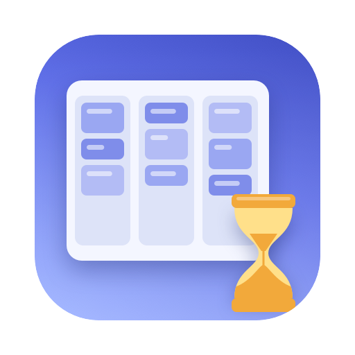

# Sprint Board

A small macOS app and desktop widget for a weekly kanban board: four lanes (To do, In progress,
Blocked, Done), one board per week, cards with a title and an optional Jira key, and "Spill over
to next week" for what did not get done. The boards are plain JSON files in your Documents folder,
so scripts (and AI coding agents) can read them and move cards from the command line.



- **App** (SwiftUI, macOS 14 or later): a sidebar of years → quarters → weeks with "This week" on
  top; the selected week as four columns. Add, edit and delete cards, drag them between lanes or
  up and down a lane to set priority, or use the right-click menu (Move to, Move to top, Move to
  bottom, Spill over to next week).
- **Widget** (Medium, Large, Extra Large): read-only, the current week's four lanes with counts,
  Jira keys in a muted mono font, spilled cards struck through. It flips to the new week on
  Monday by itself; clicking it opens the app on that week.
- **Scripts**: move or add cards and spill them over from the shell, through the app's
  `sprintboard://` URL scheme; list a week straight from its file.
- **Import** from the macOS Boards app's `.boards` files, if you kept your weeks there.

It is signed with your own Apple Developer team (a free personal team is enough) and runs from
Xcode; it is not distributed through the App Store.

## Install

1. Install Xcode (from the App Store) and, ideally, [XcodeGen](https://github.com/yonaskolb/XcodeGen):
   `brew install xcodegen`. Without it the script below patches the checked-in project instead.
2. Clone the repository and point the project at your team:

   ```bash
   git clone https://github.com/Jashvant27/sprint-board.git
   cd sprint-board
   Scripts/set-team.sh <TEAM_ID> com.yourname
   ```

   `TEAM_ID` is the 10-character id of your team: Xcode → Settings → Accounts → your Apple ID →
   the team's "Team ID". The bundle prefix only has to be unique on your Mac. The script rewrites
   the team id and the App Group id everywhere (see "Things to know" for why it must be done
   consistently) and regenerates the Xcode project.
3. Open `SprintBoard.xcodeproj`, select the `SprintBoard` scheme and My Mac, and press Run. Xcode
   signs both targets with your team. macOS asks once whether Sprint Board may access your
   Documents folder: allow it.
4. The first launch imports any `.boards` files found in `~/Documents/Sprint Boards` (see Import)
   and otherwise starts with an empty "This week". The folders are created on your first card.
5. Add the widget: click the desktop (or the date in the menu bar), Edit Widgets, search
   "Sprint Board", drag out a size.

To check that everything compiles without signing:

```bash
DEVELOPER_DIR=/Applications/Xcode.app/Contents/Developer xcodebuild -project SprintBoard.xcodeproj -scheme SprintBoard -configuration Debug CODE_SIGNING_ALLOWED=NO build
```

## Using the app

- "This week" in the sidebar is always there; the tree below lists the weeks that have a file.
  The toolbar chevrons go to the previous and next week whether or not they have a file. A week
  without a file shows empty columns and is created on its first card. Cmd+T comes back to this
  week, Cmd+N adds a card to To do.
- Drag a card onto another column or up and down its own column to reorder it; a white line
  between the cards shows where it will land while you drag. Every change animates, so you see
  cards slide to their new place, also when a script moves them.
- Click a card to select it (white border); Delete asks to delete it, Escape or a click on empty
  lane space deselects. Double-click a card (or right-click → Edit…) to edit its title and Jira
  key in a popover on the card; Return saves, Escape or a click elsewhere cancels. The "+" in a
  column header opens the same popover for a new card.
- "Spill over to next week" keeps the card in its lane, struck through with "moved to Week k ·
  Qn year" under it, and puts a copy in the same lane of next week (file and folders created if
  missing). A spilled card sinks to the bottom of its lane and can only be deleted, or followed
  with "Go to Week …".
- Closing the window quits the app. Every change rewrites the week file atomically and reloads the
  widget.

## Data

`~/Documents/Sprint Boards/<year>/Q<n>/Week <k>.json`, for example `2026/Q4/Week 4.json`:

```json
{
  "version" : 1,
  "week" : { "year" : 2026, "quarter" : 4, "week" : 4 },
  "lanes" : [
    { "lane" : "todo",  "cards" : [
      { "id" : "A049D85E-…", "title" : "Bad cable detection", "jiraKey" : "BT-990", "lane" : "todo",
        "createdAt" : "2026-10-22T13:14:03Z", "updatedAt" : "2026-10-22T13:14:03Z" },
      { "id" : "…", "title" : "Local SonarQube", "lane" : "todo", "createdAt" : "…", "updatedAt" : "…",
        "movedTo" : { "year" : 2026, "quarter" : 4, "week" : 5 } }
    ] },
    { "lane" : "prog",  "cards" : [ ] },
    { "lane" : "block", "cards" : [ ] },
    { "lane" : "done",  "cards" : [
      { "id" : "…", "title" : "Clean Desktop", "lane" : "done", "createdAt" : "…", "updatedAt" : "…",
        "movedFrom" : { "year" : 2026, "quarter" : 4, "week" : 3 } }
    ] }
  ]
}
```

- The four lanes are always present, in that order; the array order is the board order (the top
  of To do is the highest priority).
- `jiraKey`, `movedTo` and `movedFrom` are optional. `movedTo` marks a spilled card (struck
  through, not editable); `movedFrom` is on the copy in the next week.
- Keys are sorted and dates are ISO 8601 (UTC), so the files diff cleanly; keep the folder in
  git or a synced drive if you like.
- The widget cannot read `~/Documents` (widget extensions are sandboxed), so the app mirrors every
  week into one snapshot in the App Group container,
  `~/Library/Group Containers/<TEAM_ID>.<prefix>.sprintboard/Library/Application Support/SprintBoard/boards.json`,
  after every change and whenever it becomes active. The week files are the truth; the snapshot
  is derived.

### Import from the Boards app

A `.boards` file (the macOS Boards app) is a zip with `contents.html`, whose
`<script id="contents" type="application/json">` holds the board. On launch, and from Board →
Import Boards Files, every `Week <k>.boards` under `~/Documents/Sprint Boards/<year>/Q<n>/` that
has no `.json` yet is imported: lists named To Do, Doing, Blocked and Done become the four lanes
(unknown names map by position). A card in a list named Spillover goes to To do marked moved to
the next week, and a copy is added to next week's To do unless that week already has a card with
the same title. The card dates are the file's modification date. The `.boards` files are never
changed or deleted.

## The week rule

Weeks are ISO 8601 weeks (Monday to Sunday, week 1 is the week with 4 January), numbered relative
to the quarter:

    quarter      = (ISO week − 1) ÷ 13 + 1, capped at 4
    quarter week = ISO week − 13 · (quarter − 1)

So ISO weeks 1–13 are Q1, 14–26 Q2, 27–39 Q3 and 40–52 Q4: Q3 Week 13 is followed by Q4 Week 1,
and Q4 Week 4 of 2026 is ISO week 43, 19–25 October.

Edges: the year is the ISO week-based year, so 29 December 2025 belongs to Q1 Week 1 of 2026. A
53-week ISO year (2026 is one) ends with Q4 Week 14. "Next week" is always the week of Monday + 7
days, so after Q4 Week 13 comes Q4 Week 14 in such a year and Q1 Week 1 of the next year otherwise,
and the year and quarter folders are created when the first card of that week is written.
`Shared/WeekRule.swift` and `Scripts/_common.sh` implement the same rule.

## Scripts

The week files are plain JSON, so the scripts read them directly. Writes go through the app's
`sprintboard://` URL scheme, because the app owns the files and the widget's snapshot (the app has
to have run once from Xcode, which registers the scheme). The optional `[week]` is `4` (this
quarter), `Q4/4` (this year) or `2026/Q4/4`; default this week.

```bash
Scripts/set-status.sh BT-990 prog                 # Jira key or title substring, lane, [week]
Scripts/set-status.sh "bad cable" done Q4/3
Scripts/add-card.sh "Bad cable detection" BT-990  # title, [jira-key], [lane], [week]
Scripts/spill-over.sh "dependabot"                # [week]
Scripts/list-cards.sh                             # this week, lane by lane; [week]
Scripts/list-cards.sh --weeks                     # every week that has a file
Scripts/set-team.sh ABCDE12345 com.yourname       # once, after cloning
```

A match has to be unique: a Jira key that equals the query wins, otherwise the title or key has
to contain it (case-insensitive); spilled cards are skipped. Otherwise the matches are listed and
the script exits 2. The URLs the app handles:

```
sprintboard://week/<year>/<quarter>/<week>
sprintboard://set?id=<uuid>&lane=<todo|prog|block|done>[&week=2026/Q4/4]    (or q=<match> instead of id)
sprintboard://add?title=…[&jira=…][&lane=…][&week=…]
sprintboard://spill?id=<uuid>[&week=…]                                        (or q=<match>)
sprintboard://import
```

This is what makes the board useful with an AI coding agent: tell it to run `set-status.sh` when
it starts on a card and when the work is merged, and the board on your desktop follows the work.

## Layout

- `Shared/` compiled into both targets: `Model.swift` (WeekID, Lane, Card, Board),
  `WeekRule.swift`, `SharedStore.swift` (the widget snapshot and the debug-logging setting).
- `SprintBoard/` the app: `BoardStore.swift` (week files, atomic writes, mirroring, spill-over,
  import), `BoardsImporter.swift`, `ContentView.swift` (sidebar, URL scheme), `BoardView.swift`
  (columns, cards, drag and drop with the drop line, popover editor), `SprintBoardApp.swift` (menus, Settings, quit on close).
- `SprintBoardWidget/` the widget. `Scripts/` the shell scripts and the icon renderer.
- `project.yml` is the XcodeGen source of `SprintBoard.xcodeproj`; after editing it run
  `xcodegen generate`.

## Icon

`Scripts/make_icon.swift` draws the icon with CoreGraphics (no bitmap source) into
`SprintBoard/Assets.xcassets/AppIcon.appiconset` at every macOS size, plus a preview:

```bash
swift Scripts/make_icon.swift SprintBoard/Assets.xcassets/AppIcon.appiconset Design/icon-preview.png
```

## Things to know

- The app is not sandboxed (it reads and writes `~/Documents/Sprint Boards` directly); only the
  widget is, as macOS requires. Both carry the App Group entitlement, and its id is
  **Team-ID-prefixed** (`<TEAM_ID>.<prefix>.sprintboard`), not `group.`-prefixed: a personal
  team's provisioning carries no App Groups capability, and macOS validates the Team-ID form from
  the signature alone. With a `group.` id the widget never sees the snapshot. The id lives in the
  two entitlements files, `project.yml` and `Shared/SharedStore.swift`; `Scripts/set-team.sh`
  keeps them in step.
- The shared state is a JSON file in the group container, not `UserDefaults(suiteName:)`: the
  preferences daemon keeps App Group suite writes of a locally signed app in memory only.
- If the widget looks stale, open the app once (it rebuilds the snapshot and reloads the widget),
  or `killall chronod`. "No board for Week k yet" means the week has no file: add a card.
- After changing the team or entitlements, quit a running copy of the app before the next Run: a
  running process keeps its old entitlements.
- Settings (Cmd+,) has one switch, "Debug logging": the board and the widget then end with the
  week file's path, the snapshot's path and size and the last write error. "no group container"
  there means the signature lost the App Group entitlement.
- `xcodebuild` from the shell needs `DEVELOPER_DIR=/Applications/Xcode.app/Contents/Developer`
  when the Command Line Tools are the active developer directory.

## License

MIT, see `LICENSE`.
